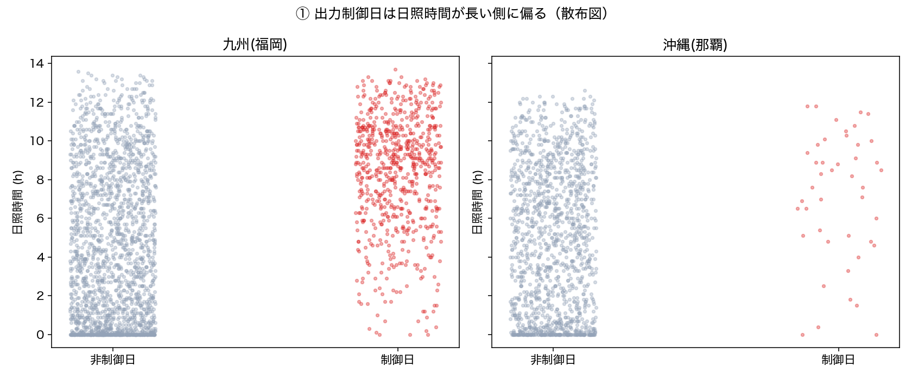
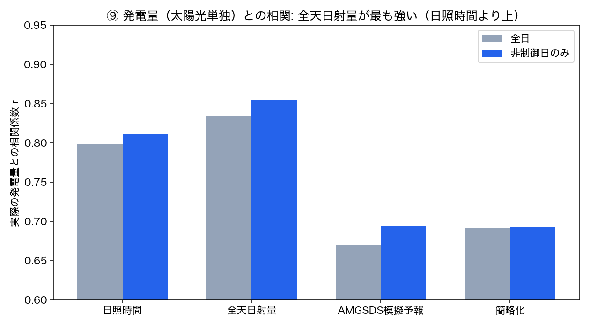
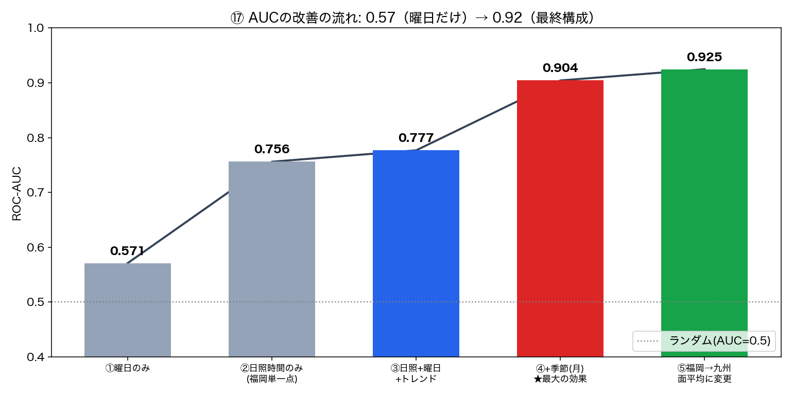
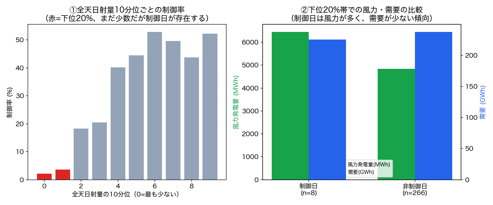

<!-- _class: lead -->
<!-- _paginate: false -->

# 太陽光の出力制御は天気で説明できるか

## 九州 vs 沖縄 — 実際の制御実績での検証

solar_curtailment_kyushu ／ 2026-10

---

## 問いと結論

**出力制御（カーテイルメント）は「晴天」と「低需要（休日・季節）」で説明できるか？**

- 九州電力送配電・沖縄電力の**実際の出力制御実績**＋気象庁データで検証
- 結論: **説明できる。九州を本命に進めるのが妥当**
  - 晴天: 制御日の日照時間 8.46h vs 非制御日 4.58h（Cohen's d=1.07）
  - 休日: 土日の割合 39.2%（カレンダー基準 28.6%）。ただし**季節で大きく異なる**
  - 予測: 季節＋日照＋曜日で **ROC-AUC 0.925**

---

## データと比較（九州 vs 沖縄）

| 項目 | 九州 | 沖縄本島 |
|---|---|---|
| 実績データ形式 | Excel（機械的にパース可） | PDF（テキスト抽出が必要） |
| 対象期間 | 2018〜2025年度（8年） | 2022〜2025年度（4年） |
| 制御日数 | **715日** | **44日** |
| 土日の割合 | 39.2% | 59.1% |
| 日照時間（制御 vs 非制御） | 8.46h vs 4.58h | 7.16h vs 4.84h |
| Cohen's d | 1.07 | 0.63 |
| 判定 | **GO** | 一部GO（データ短く信号が弱い） |

---

## 重大な訂正: 「制御日」の判定バグ

- 実績報告書には2段階: **前日指示**（予報ベース）→ **速報**（当日実況で見直し）
- 当初は前日指示だけを読み、**当日の取り消しを見逃していた**（ユーザー指摘で発見）

| | 修正前 | 修正後 |
|---|---|---|
| 九州の制御日数 | 1,175日 | **715日**（-39%） |
| 沖縄の制御日数 | 160日 | **44日**（-72.5%） |

ノイズが除かれ、**信号はむしろ強くなった**（日照時間 d: 0.73→1.07、AUC: 0.852→0.904）

---

## 晴れた日に制御が多い

---

## 土日に多い — ただし季節で正反対

| 季節 | 制御日数 | 土日の割合 |
|---|---|---|
| 春（3〜5月） | 多い | 低い（29〜34%）= 平日も供給過多 |
| 夏〜初秋（7〜9月） | 少ない | **極めて高い（83〜100%）** |
| 秋冬（10〜2月） | 中程度 | 中程度（41〜56%） |

- 夏は冷房需要で平日の需要が高く、**土日だけ**が供給過多になる
- 全体の39.2%は**全く異なる2つの季節パターンの平均**
- 沖縄は5〜10月の制御が**0日**（季節が有無を分ける）

---

## 日照時間 vs 全天日射量: 目的変数で逆転

- **出力制御の有無（二値）** → 日照時間の方が判別力が高い
  - 制御は「昼ピークで供給が需要を超えるか」という**閾値イベント**
- **発電量（連続量）** → 全天日射量の方が相関が高い（r=0.835 vs 0.799）

---

## ロジスティック回帰でどこまで予測できるか（九州）

| 特徴量 | ROC-AUC |
|---|---|
| 曜日（土日祝）のみ | 0.571 |
| 日照時間のみ | 0.756 |
| 日照時間＋曜日 | 0.777 |
| ＋季節（月）＋トレンド | 0.904 |
| **日照を九州7県平均に（面で見る）** | **0.925** |

- 時系列分割（前70%学習／後30%評価）で評価
- **季節（月）は日照・曜日に匹敵する強力な予測因子**
- トレンド項で再現率 0.241→0.515（太陽光導入量の増加による分布シフトを補正）

---

## AUC改善の流れ

---

## 点より面: 九州全体で見ると精度が上がる

| 日照の取り方 | AUC（フル） |
|---|---|
| 福岡 単一点 | 0.904 |
| AMeDAS 九州7県平均 | **0.925** |
| AMGSDS 九州メッシュ面平均 | 0.924 |

- 制御は九州全域の系統で起きる現象 → 1点より面が適切
- **高解像度メッシュを使わなくても、気象官署7点の平均で十分**（運用コストも低い）
- トレンド項を実導入容量（738万→1,270万kW）に置換してもAUCは不変

---

## 低日射量でも制御がある日の要因

- 日射量下位20%帯の制御日8日のうち、6〜7日は**風力・需要低下**で説明可能
- 1日（2025-02-14）は未解明。基本構造（晴れ×低需要）は揺るがない

---

## 前日判断と当日判断の比較

| | 前日指示のみ | 最終決定 | 取り消し率 |
|---|---|---|---|
| 九州 | 1,170日 | 715日 | 39.4% |
| 沖縄 | 160日 | 44日 | **72.5%** |

- 曜日・季節パターンの「形」は同じ → **前日の見通しから存在する頑健な傾向**
- 沖縄は予報と実況のズレが大きく、相関が弱い一因と考えられる

---

## 予報の使い方: AMGSDSは「正確」ではなかった

- AMGSDS（農研機構）の日照予報は**快晴日に約5h過少評価**（那覇、n=21）
- 快晴日は出力制御が最も起きやすい日 → 不利
- バックテスト: 簡略化 AUC 0.768 > AMGSDS模擬 0.706
- **2026-10-06 方針変更**: AMGSDS依存を廃止し、**気象庁の天気予報（7県集約）だけ**で完結
- 明日の判定を3段階（低<30%・中<60%・高≥60%）で表示し、Claudeが背景を平文で補足

---

## 限界と今後

**限界**
- 制御の**量**（kW）は未検証（有無の二値のみ）
- 沖縄は那覇1地点で代表させており、相関の弱さの原因を分離できていない
- 天気予報→日照時間は分位点による簡略化（参考情報の位置づけ）
- 予報アーカイブが無く、予報手法の実績での直接検証は不可

**次にやること**
- 沖縄の代表点見直し／FY2026分公開後の再検証
- 天気予報と数値予報を多数日分ペアで集め、分位点マッピングをデータで補正

---

<!-- _class: lead -->

## まとめ

**出力制御は「晴れ × 低需要（休日・季節）× 導入量の増加」でかなり説明できる**

九州なら ROC-AUC **0.925**。ただし最終判断は電力会社の公式発表で。

詳細: README.md ／ REPORT.md ／ CORRECTIONS_LOG.md
